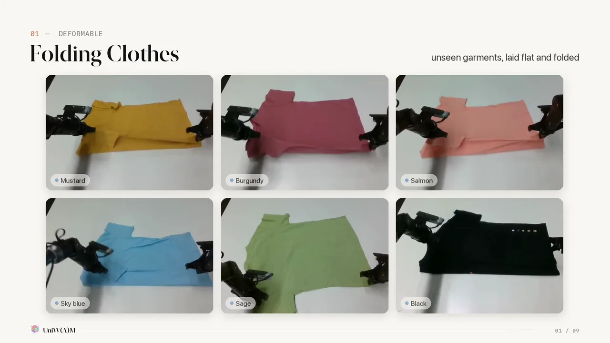
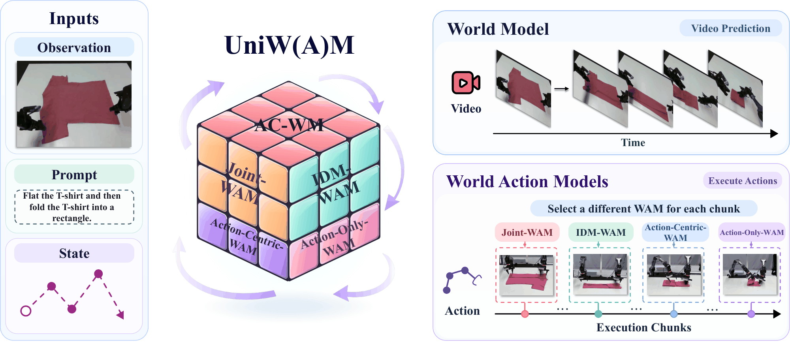

<div align="center">


# UniW(A)M

### A Unified Mixture-of-Experts Framework for World and World-Action Models

Jingbo Xu<sup>1*</sup>, Jianjie Fang<sup>1*</sup>, Zhuohang Li<sup>1</sup>, Zihao Song<sup>1</sup>, Zhaolu Wang<sup>2</sup>, Xvyuan Liu<sup>3</sup>, Xin Zhang<sup>4</sup>, Haisheng Su<sup>4</sup>, Yinzhou Tang<sup>1</sup>, Chen Gao<sup>1,2†</sup>, Wei Wu<sup>4†</sup>, Yong Li<sup>1†</sup>

<sup>1</sup>Tsinghua University &nbsp; <sup>2</sup>Zhongguancun Academy &nbsp; <sup>3</sup>East China Normal University &nbsp; <sup>4</sup>Manifold AI

<sup>*</sup>Joint first authors &nbsp; <sup>†</sup>Corresponding authors

[](https://xumanba.github.io/UniW-A-M/)
[](https://arxiv.org/abs/2610.18697)
[](https://huggingface.co/xumanba/UniWAM)
[](LICENSE)

<a href="https://xumanba.github.io/UniW-A-M/"></a>

<sub>Real-world and simulation episodes. Full videos and interactive results are on the <a href="https://xumanba.github.io/UniW-A-M/">project page</a>.</sub>

</div>

## Table of Contents

- [Overview](#overview)
- [Updates](#updates)
- [Model Checkpoints](#model-checkpoints)
- [Installation](#installation)
- [Model Assets](#model-assets)
- [Data Preparation](#data-preparation)
- [Training](#training)
- [Inference](#inference)
- [Repository Layout](#repository-layout)
- [Citation](#citation)

## Overview

**UniW(A)M** is a mixture-of-experts world-(action) model built on the Wan2.2-TI2V-5B diffusion Transformer. One backbone serves five video–action interfaces: action-conditioned world modeling (**AC-WM**) and four world-action-model interfaces (**Joint-WAM**, **IDM-WAM**, **Action-Centric-WAM** and **Action-Only-WAM**).

- **Shared and atomic experts**: a shared expert captures common dynamics, and four atomic experts (VGM, VLA, WM, IDM) are reused by every interface that needs them.
- **Capability-Aligned Token Routing (CATR)**: video and action tokens are routed to their own eligible experts.
- **Plug-in Adaptive Interface Router (PAIR)**: picks an interface for each action chunk at deployment, with the backbone frozen.

<p align="center"></p>

For results and analyses, see the [paper](https://arxiv.org/abs/2610.18697) and the [project page](https://xumanba.github.io/UniW-A-M/).

## Updates

- **[2026-11]** Released the training and inference code, the UniW(A)M initialization weights, and the real-world Folding Clothes checkpoint.

### Open-Source Roadmap

- [x] Training and inference code for all five interfaces
- [x] UniW(A)M initialization weights
- [x] Real-world Folding Clothes checkpoint
- [ ] LIBERO checkpoint
- [ ] RoboTwin 2.0 checkpoint
- [ ] PAIR training and deployment code

## Model Checkpoints

| Model | Description | Download |
| --- | --- | --- |
| UniW(A)M initialization | DiT with each FFN copied into five experts and a zero-initialized router; the starting point for training | [`pretrained/`](https://huggingface.co/xumanba/UniWAM/tree/main/pretrained) |
| UniW(A)M Folding Clothes | Complete checkpoint for the real-world Folding Clothes task (AgileX dual-arm) | [`folding_clothes/`](https://huggingface.co/xumanba/UniWAM/tree/main/folding_clothes) |

```bash
mkdir -p checkpoints
hf download xumanba/UniWAM --include "pretrained/*" --local-dir ./checkpoints/UniWAM
hf download xumanba/UniWAM --include "folding_clothes/*" --local-dir ./checkpoints/UniWAM
```

## Installation

Use Linux, Python 3.11, an NVIDIA GPU environment with BF16 support, and an
NVIDIA driver compatible with the chosen PyTorch CUDA build. The example below
uses PyTorch 2.8.0, torchvision 0.23.0 and CUDA 12.8 wheels.

### Create and activate an environment

```bash
git clone https://github.com/xumanba/UniW-A-M.git
cd UniW-A-M

conda create -n uniwam python=3.11 -y
conda activate uniwam
conda install -c conda-forge ffmpeg -y
python -m pip install --upgrade pip setuptools wheel
```

Run the remaining commands from the checkout root, with the `uniwam`
environment activated.

### Install PyTorch and project dependencies

```bash
nvidia-smi
nvcc --version

python -m pip install torch==2.8.0 torchvision==0.23.0 \
  --index-url https://download.pytorch.org/whl/cu128

DS_BUILD_OPS=0 python -m pip install -r requirements.txt
python -m pip install -e . --no-deps
```

`requirements.txt` is the single dependency list for training and inference;
`pyproject.toml` reads the same file. DeepSpeed and Ninja are included. DeepSpeed
uses JIT compilation for its CUDA extensions, so provide a C++ compiler and
a CUDA toolkit matching the PyTorch build when those extensions are needed.
On Ubuntu, the compiler can be installed with
`sudo apt-get install -y build-essential`. Set `CUDA_HOME` to your actual CUDA
toolkit directory if it is not detected automatically.

Other supported PyTorch CUDA wheels are listed in the official
[PyTorch installation guide](https://pytorch.org/get-started/previous-versions/#v280).
See [DeepSpeed installation](https://www.deepspeed.ai/tutorials/advanced-install/)
for toolkit/extension setup. FlashAttention is optional: the implementation has
a PyTorch SDPA fallback and does not require it for the basic installation.

### Check the installation

```bash
python -m pip check
python -c "import torch; print('PyTorch:', torch.__version__); print('CUDA build:', torch.version.cuda); print('GPUs:', torch.cuda.device_count()); assert torch.cuda.is_available()"
python -m deepspeed.env_report

python train.py --dry-run
python infer.py --dry-run --task joint_dreamzero
```

The dry runs compose configuration without loading data or model weights.
They are useful before a launch; CUDA availability and dependency compatibility
are checked separately by the preceding commands.

## Model Assets

Download the [Wan2.2-TI2V-5B](https://huggingface.co/Wan-AI/Wan2.2-TI2V-5B)
backbone, text encoder, VAE and tokenizer. The image encoder comes from the
upstream [Wan2.1-I2V-14B-480P](https://huggingface.co/Wan-AI/Wan2.1-I2V-14B-480P)
assets. With the Hugging Face CLI installed:

```bash
export UNIWAM_ASSETS=/path/to/Wan2.2-TI2V-5B

hf download Wan-AI/Wan2.2-TI2V-5B --local-dir "$UNIWAM_ASSETS"
hf download Wan-AI/Wan2.1-I2V-14B-480P \
  models_clip_open-clip-xlm-roberta-large-vit-huge-14.pth \
  --local-dir "$UNIWAM_ASSETS"
```

The directory should contain:

```text
Wan2.2-TI2V-5B/
  diffusion_pytorch_model.safetensors.index.json
  diffusion_pytorch_model-*.safetensors
  Wan2.2_VAE.pth
  models_t5_umt5-xxl-enc-bf16.pth
  models_clip_open-clip-xlm-roberta-large-vit-huge-14.pth
  google/umt5-xxl/                 # tokenizer files
```

By default the DiT is initialized from the dense Wan2.2 weights in this
directory, and each FFN is copied into the five experts when the model is
built. To start from the released UniW(A)M initialization instead, point
`dit_version` at the downloaded `pretrained/` folder (see [Training](#training)).
You can also set `dit_version`, `text_encoder_pretrained_path`,
`image_encoder_pretrained_path`, `vae_pretrained_path` and `tokenizer_path`
individually if your assets are stored separately.

## Data Preparation

Set the path to a converted trajectory dataset:

```bash
export UNIWAM_DATA=/path/to/prepared_trajectories
```

The supplied adapter expects three camera views (`head`, `left_wrist`,
`right_wrist`), 20D bimanual absolute EEF state/actions, language instructions
and aligned 30 FPS trajectories in LeRobot-style storage:

```text
prepared_trajectories/
  meta/
    info.json
    modality.json
    embodiment.json
    stats.json
    tasks.jsonl
    episodes.jsonl
  data/chunk-000/episode_000000.parquet
  videos/chunk-000/<camera-key>/episode_000000.mp4
```

For an existing converted 20D EEF dataset with `observation.state`, `action`,
`task_index` and valid task descriptions, prepare matching metadata in a new
directory:

```bash
EEF_KEYS='{"left_pos":[0,3],"left_rot6d":[3,9],"left_gripper":[9,10],"right_pos":[10,13],"right_rot6d":[13,19],"right_gripper":[19,20]}'

python -m tools.data.prepare_metadata \
  --dataset-path /path/to/converted_eef_data \
  --output-path "$UNIWAM_DATA" \
  --embodiment-tag agilex_eef \
  --state-keys "$EEF_KEYS" --action-keys "$EEF_KEYS" \
  --task-key task_index
```

This tool prepares metadata; it does not convert raw benchmark actions into
EEF poses or change camera layouts. LIBERO and RoboTwin use the same trainer
after conversion or a matching data adapter, with no separate training code.
See [data preparation](docs/data.md) for coordinates, vector ordering, value
ranges and temporal alignment.

## Training

### Fresh training on one node

```bash
torchrun --standalone --nproc_per_node=8 train.py \
  assets_root="$UNIWAM_ASSETS" \
  dataset_root="$UNIWAM_DATA" \
  output_dir=./outputs/uniwam \
  per_device_train_batch_size=3 \
  global_batch_size=192 \
  max_steps=100000 save_steps=5000
```

To initialize from the released UniW(A)M weights, add
`dit_version=./checkpoints/UniWAM/pretrained`. The expert and router weights
are loaded after the MoE layers are created, and loading stops with an error
if any of them is missing.

Set `--nproc_per_node` to the number of GPUs used on that node. Even a one-GPU
launch uses `torchrun --standalone --nproc_per_node=1`. The MoE model has
substantial memory requirements; the example is a launch template rather than
a measured minimum hardware configuration.

Training uses all five interfaces with probability 0.2 each. The default
recipe uses token-group MoE, dense unified training attention, AdamW with
learning rate `1e-5`, and 1,000 warmup steps followed by a constant learning
rate. Each window contains 33 frames, 96 actions and 4 states.

The entry point computes gradient accumulation as
`global_batch_size / (total_GPU_processes * per_device_train_batch_size)`.
This must be a positive integer. Checkpoints and configuration are written
under `output_dir`; use a new directory for each independent training run.

### Common training overrides

| Setting | Example | Meaning |
| --- | --- | --- |
| Learning rate | `learning_rate=1e-5` | AdamW learning rate |
| Training length | `max_steps=100000` | Optimizer steps |
| Save interval | `save_steps=5000` | Checkpoint interval |
| Activation checkpointing | `gradient_checkpointing=true` | Trade computation for GPU memory |
| Local checkpoint retention | `save_total_limit=5` | Number of retained checkpoints |
| Data workers | `dataloader_num_workers=2` | Workers per training process |

These are Hydra `key=value` overrides, not `--learning-rate` style flags. The
shared recipe is in [configs/unified.yaml](configs/unified.yaml). The included
DeepSpeed configuration uses ZeRO-2 with communication overlap.

### Training on multiple nodes

For two nodes with eight GPUs each, run the following on both nodes, setting
the same reachable master address and port. Each node must see the same assets,
dataset and shared output directory.

```bash
# Node 0
torchrun --nnodes=2 --nproc_per_node=8 --node_rank=0 \
  --master_addr=MASTER_NODE_ADDRESS --master_port=29500 train.py \
  assets_root="$UNIWAM_ASSETS" dataset_root="$UNIWAM_DATA" \
  output_dir=/path/to/shared_output \
  per_device_train_batch_size=3 global_batch_size=192

# Node 1
torchrun --nnodes=2 --nproc_per_node=8 --node_rank=1 \
  --master_addr=MASTER_NODE_ADDRESS --master_port=29500 train.py \
  assets_root="$UNIWAM_ASSETS" dataset_root="$UNIWAM_DATA" \
  output_dir=/path/to/shared_output \
  per_device_train_batch_size=3 global_batch_size=192
```

### Initialize a new run from a UniW(A)M checkpoint

```bash
torchrun --standalone --nproc_per_node=8 train.py \
  pretrained_model_path=/path/to/complete_checkpoint \
  tokenizer_path="$UNIWAM_ASSETS/google/umt5-xxl" \
  dataset_root="$UNIWAM_DATA" \
  output_dir=./outputs/uniwam_finetune
```

With a fresh output directory, this loads model weights and starts a new
optimizer. Full optimizer/scheduler continuation additionally requires the
exact saved task-stream state; it is not the same as this command. See
[training details](docs/training.md) for continuation semantics.

## Inference

Use a complete UniW(A)M checkpoint containing `config.json` and model weights
(single file or index plus all shards). The checkpoint supplies the model
components, while the T5 tokenizer remains an external input. The command below
runs one offline trajectory window on a single GPU and reports action MSE over
valid action channels:

```bash
CUDA_VISIBLE_DEVICES=0 WAM_EVAL_NUM_SAMPLES=1 WAM_EVAL_STEPS=16 \
python infer.py --task action_only_gigaworld_policy \
  pretrained_model_path=/path/to/complete_checkpoint \
  tokenizer_path=/path/to/Wan2.2-TI2V-5B/google/umt5-xxl \
  dataset_root=/path/to/prepared_trajectories
```

Checkpoints written by this code also contain `experiment_cfg/effective_config.json`,
which is checked against the launch configuration. The released
`folding_clothes/` checkpoint predates that file, so set
`ALLOW_LEGACY_EFFECTIVE_CONFIG=1` when using it:

```bash
CUDA_VISIBLE_DEVICES=0 ALLOW_LEGACY_EFFECTIVE_CONFIG=1 WAM_EVAL_NUM_SAMPLES=1 WAM_EVAL_STEPS=16 \
python infer.py --task idm_lingbot_va \
  pretrained_model_path=./checkpoints/UniWAM/folding_clothes \
  tokenizer_path="$UNIWAM_ASSETS/google/umt5-xxl" \
  dataset_root="$UNIWAM_DATA"
```

Change only `--task` to select another interface using the same model:

| Interface | `--task` | Prediction |
| --- | --- | --- |
| Joint-WAM | `joint_dreamzero` | Joint actions and future video |
| IDM-WAM | `idm_lingbot_va` | Future video, then actions |
| Action-Centric-WAM | `action_only_fast_wam` | Actions |
| Action-Only-WAM | `action_only_gigaworld_policy` | Actions |
| Action-Conditioned World Model | `ac_wm` | Future video given recorded actions |

For example, use `--task joint_dreamzero` for Joint-WAM or `--task ac_wm` for
action-conditioned video prediction. AC-WM reports generated video dimensions
and does not produce executable actions. `WAM_EVAL_STEPS` sets the denoising
steps; `WAM_EVAL_NUM_SAMPLES` sets the offline batch size.

The entry point evaluates against recorded observations and prints results to
the terminal. It does not start a robot server or a simulator rollout. See
[inference details](docs/inference.md) for the shared chunk API, cache lifecycle
and interface switching.

## Repository Layout

```text
train.py                  Shared backbone training entry
infer.py                  Five-interface offline inference entry
requirements.txt          Training and inference dependencies
configs/unified.yaml      Shared runtime recipe
groot/vla/model/          Backbone, MoE, encoders, VAE and routing
groot/vla/data/           Dataset schemas, loaders and transforms
groot/vla/experiment/     Trainer and checkpoint utilities
groot/vla/configs/        Composable model/data configuration
uniwam/                   Public CLI and inference helpers
tools/data/               Dataset metadata preparation
docs/                     Architecture and detailed usage guides
```

The `groot` namespace is retained for model imports and checkpoint class paths.

## Citation

```bibtex
@article{xu2026uniwam,
  title   = {UniW(A)M: A Unified Mixture-of-Experts Framework for
             World and World-Action Models},
  author  = {Xu, Jingbo and Fang, Jianjie and Li, Zhuohang and Song, Zihao and
             Wang, Zhaolu and Liu, Xvyuan and Zhang, Xin and Su, Haisheng and
             Tang, Yinzhou and Gao, Chen and Wu, Wei and Li, Yong},
  journal = {arXiv preprint arXiv:2610.18697},
  year    = {2026}
}
```

## Acknowledgements and license

This implementation builds on [DreamZero](https://github.com/dreamzero0/dreamzero),
its GR00T-derived utilities, and the Wan video backbone. Upstream copyright
and source notices are retained in [COPYRIGHT](COPYRIGHT), [LICENSE](LICENSE)
and applicable source headers. This release adds the unified MoE/interfaces,
entry points and configuration. The code and the released UniW(A)M weights are
licensed under Apache-2.0; third-party model weights and dependencies remain
subject to their own distribution terms.
